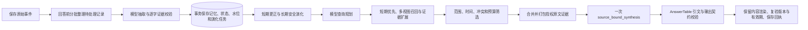

# 长短期记忆系统架构

本系统采用模块化单体后端。SQLite 保存权威事件、事实与审计，检索索引和摘要均为可重建投影。HTTP 展示前端与可选 Engine 适配器调用同一个 `MemoryRuntime`；本轮不包含真实课程宿主集成验收。

## 模块边界

| 层 | 模块 | 职责 |
|---|---|---|
| 展示 | 相邻 `memory-ui/` | React/TypeScript 展示对话、真实运行阶段、检索证据、生命周期及加速观测 |
| 协议 | `api.py`、`integrations/rag_sdk.py` | HTTP/NDJSON、可信身份范围、参数校验和错误映射 |
| 应用 | `runtime.py`、`short_term.py`、`long_term.py` | 自动抽取、状态更新、演化重试、维护与回答编排 |
| 检索 | `retrieval.py`、`retrieval_projection.py` | 意图规划、混合候选、证据关系扩展、预算选择及索引投影 |
| 答案 | `grounding.py`、`composition.py`、`synthesis.py` | 原文来源打包、集合来源检索、单次答案表生成后的校验和渲染 |
| 时间 | `temporal.py` | 日期和相对时间解析、区间及精度表达、日历差值；其他模块调用同一实现 |
| 领域 | `models.py`、`ports.py`、`evidence_policy.py`、`maintenance.py` | 数据契约、证据规则、关系与保留策略 |
| 基础设施 | `store.py`、`providers.py`、`embeddings.py`、`acceleration.py` | SQLite、模型服务、向量服务及生成缓存 |

核心包不导入 FastAPI 或课程 SDK。SimpleMem、Zep、H-MEM 是方法参考，不是被直接调用的运行时组件。

## 在线闭环

`answer` 默认先处理积压，每批最多 5 个新 turn，最多补充 15 个已处理 turn 作为语境；turn 是持久化记录单位，不保证等于完整的用户—助手对话轮。`search` 保持只读，不自动调用抽取。手动 `/extract` 仍可独立运行。

上图是支持 `synthesize` 的模型适配器处理直接问答时的唯一生产答案链。模型返回一个 `AnswerTable`，
其中记录结论、支持引文、必填且至多 1000 字符的 `derivation` 建模摘要，以及缺失条件。摘要与答案来自
同一次调用，保存供审计而不进入最终答案；它不是额外生产线，也不是推理正确性的证明。当前 concise 提示
要求 `values` 输出最短完整答案，保留必要限定、单位和所问列表成员，说明放在 `derivation`；发布器不做事后截断。正常生成限一次请求，最多再进行一次
Schema/证据修复；实际供应商请求受次数和序列化提示长度边界约束。失败不会切换到 reader fallback、
集合 IR、semantic binding 或额外偏好 profile 等答案分支。查询规划和记忆抽取是独立阶段，不计作这一次生成。

同一答案值可声明 `operation=count/sum` 与 `inputs`，每个输入直接使用已有 `source_id + quote`
引用，保留成员身份、关系说明及显式数量。程序只对这些已选输入去重和计算，汇总模型已经选择的引文；
没有局部支持索引或第二答案生成器。普通答案、直接陈述的总数及近似结果使用 `operation=none`。
计算不能证明成员选择完整或引文语义蕴含成立；这些仍需模型判断和逐题实验审计。

2026-11-17 的机械兼容修复保留模型首次请求的原生成要求。provider 在局部生成 Schema 中保留
`value` 的700字符简洁目标，接收端的公开 Schema 与解析器则不以此作为内容硬上限；超长但通过
原有来源和输出检查的文本完整保留。引文700、其它结构限制和实际 provider 输出预算没有扩大。
普通 `operation=none` 合并引用后使用原平铺引用契约，不再因同一引用被放入未执行的 `inputs`
而重复要求每组为断言；`count/sum` 仍逐操作数检查。规范数字与独立 `unit` 可表示相同计算值，
错数、错单位及条件限定不因此变为等价。

失败反馈复用同一确定性计算函数，补出首个错误之后已可计算的独立冲突；只有 `AnswerTable`
的错位 `slot.supports` 错误才提示把有效引用迁移到它实际支持的值或操作数。程序不自动复制引用，
不新增输出字段，不绕过个性化建议的用户依据检查，仍只有原来一次修复。
完整回放的成功保持与验收失败候选见 [本轮审计](../../result/structural_repairs_20261117/README.md)。

`missing_kind` 区分独立未答项、必要前提与非必要细节。某个值显式声明 `unresolved_premise` 时，
仅该值不发布，缺口写入同一答案表，独立有据值保留。新建议可共享同一目标内已引用的个人依据，
不要求每条一般性建议在历史中已经出现；整个建议目标仍必须引用用户陈述。程序不自动补引文。
来源事件内的 `extraction_hint` 仅映射已有记忆引用到当前可见原文，随证据一起计入打包预算，
属于可纠正抽取提示，不是新的事实来源；不得从可见成员子集推断集合完整。

2026-11-17 修复已有 slot `role=answer/context` 的消费者不一致：覆盖状态、渲染、发布引用和建议
个人依据共用 `answer_values`。context 保留在审计表中，不作为正面答案或引用发布，亦不因其缺口
污染独立答案。没有新增模型输出字段，生成提示及 AnswerTable Schema 与本轮开始版本一致。
`question_only` 另修复带明确逗号边界的 When/Where 陈述从句误判：保留原文中的真实陈述，
真正疑问主句仍不能作为事实依据。该修复不新增模型调用，也不声称覆盖所有英语语法。

本轮试验过的关键词替换 extraction_hint、新 value role、target 去重及附加生成说明未通过真实
开发题验收，已撤回，不留开关。
冻结失败候选与全部费用保存在 result/cost_followup_20261117；角色声明的执行一致性并不证明
模型声明本身正确，阶段完整覆盖、关系前提和建议事实可信度仍需单独验证。

未实现 `synthesize` 的旧适配器及 `action_plan` 请求保留 plain-answer 接口和精确生成缓存。
该兼容接口不是结构化生成失败后的备用答案链。只有此接口构建会被提示消费的事件图；主 synthesis
回执记录实际来源、答案表和调用预算，不计算仅用于展示数量的答案图或负向 gate。
持久化记忆关系及检索中的关系扩展继续保留。旧回执中的 `AnswerContract` 和自由结构的 reasoning
仍可读取；当前 planner 不再索取这个旧契约。

时间表达统一由 `temporal.py` 解析，保留明确年份、原文精度和来源锚点。来源 `occurred_at` 是观察时间，
不是每个被提及事件的发生时间。`Retriever._eligible` 与 lifecycle/blocked-event 边界仍以 `plan.as_of`
检查事实的 `valid_from/valid_to`，不把它用于裁掉后来追述该事实的话语。给定 history 中的原文按既有
权限、撤回和生命周期规则使用。`Question date` 只作为相对时间参考；它与问题里的事件日期都不能
自动变成知识访问截止。当前没有通用 as-known-at 查询契约，也不保留闲置的观测截止参数或解析器。
曾从 Question date 小时推出来源截止的 source_clock 已撤回：官方完整上下文协议提供全部 history，
而数据编译未保证同日 session 时分早于 question 时分。此后 source_visible 使用统一源码重新评测；
失败阶段源码、结果和费用保留。主 provider 通过 `resolve_time_references` 生成
来源局部的 canonical `TimeReference` 供同次 synthesis 建模，`synthesis.py` 校验引用和输出结构，
不执行 `calculation/computation/time_expression` 发布 DSL，也不依据日期、问题或事件图改写答案值。
上述限制不影响答案值自身明确声明的精确 `count/sum`；它们消费显式操作数，不推断日期或补齐未知时长。
旧 plain-answer adapter 及 `_source_event` 元数据仍可携带 `derive_times/time_derivations` 诊断；主 provider
使用 `include_time=False` 排除这些旧诊断，避免两套时间输入。ISO 日期显示格式可以规范化，但不重解相对时间；
极性前缀和数值下界也不再触发丢弃解释、单位或建议的格式改写。

2026-11-16 补齐查询规划的日期传递：runtime 在剥离问题元数据前取得同一问题参考日期，
传入既有 planner 的 `query_time`。生成与规划使用同一日锚点；无有效日期时沿用当前时钟。
该参考值不替换权限、生命周期及请求期限的时钟，也不构成原文访问截止。

现有证据打包器对集合查询保留标题与连续列表的结构依赖，仍受原序列化字符预算限制；
空间不足时退回成员候选，非集合及序号查询保持原局部片段行为。这不证明全库枚举完整。
答案校验对回忆/推导值中的显式 `@` 标识符检查所引原文拼写，不模糊替换答案。
既有一次修复的反馈给出所引原文中可用的标识符，或同证据包中可引用的用户来源编号；
不放宽来源断言规则、不增加模型调用阶段。来源完整性和修复成功率仍须单独实测。

原文、抽取结果、摘要和处理水位在同一事务中提交，演化任务同时写入 SQLite outbox。抽取模型、Schema 或证据校验失败时水位不推进；抽取提交后演化失败返回可见警告，任务保留，后续调用可重试，重启后仍可恢复。回答规划或生成失败不会撤销已经成功提交的抽取。

窗口预算采用现有字符估算，不能当作模型 tokenizer 的精确 token 数。首条超预算新 turn 单独处理，
不再附加上下文；历史 turn 放不下时恢复原连续选择策略并停止，原序号、角色和时钟仍保留。
曾试验跳过长记录继续补更早短记录，但真实建库更贵且未改善集合完整性，该增强及提示已撤回。
状态预算计入即将提交的 revision、水位和时间戳长度；
启用裁剪时提交实际裁剪后的模型状态，保留调用方的 topic/project，原始模型响应仍可审计。
默认关闭裁剪的实验不构成该分支的端到端验证，其提交边界另由事务测试覆盖。

查询规划的最终主体与约束传给 indexed 补召回及现有 route 消费者，collection 分支也传递约束；
原 route 的类型、预算政策与来源资格保留。最终计划没有额外复制成 reader 的第二份问题解释。
indexed 补传完整 semantics 的候选虽通过引用绑定检查，但改变了提示与预算选择，所属集成版本
未通过实际质量验收，当前没有启用。覆盖奖励仍不等价于完整集合枚举，不能据此声明集合问题已解决。

## 证据与记忆演化

- 每个候选必须引用本批至少一个新 turn，并提供准确事件位置和逐字引文。
- 答案引文校验只证明 provenance：所引文字来自选定来源。它不等于 entailment，不能独自证明主体、事件、角色、时间条件或答案推理成立；这些错误仍需逐题和独立评估。
- 推荐答案可共用同一 answer slot 内经验证的用户陈述作为个人依据；新建议本身不必有历史逐字引文，回忆和推导值仍须有原文支持。context slot、其他 slot 的用户陈述、纯助手来源或用户问句不能替代此依据。
- 问句属于对话语境，不能建立肯定事实；截掉问号或混入助手回答不能绕过原事件检查。助手输出本身不能证明用户事实。
- 用户证据支持的持久、用户/项目范围陈述可以自动晋升；临时约束仍保留在会话范围。
- 相同结构化事实允许措辞不同，但合并必须保持主体、属性、值、断言、作用域和有效期一致，并保留证据。
- 明确现实变化使用 `supersede`，关闭旧有效期并建立新版本；明确原说法错误使用 `correct`，撤回错误版本。已声明单值关系中依据不充分的异值候选进入 `pending`；多值关系保留成员操作，未知关系保留并存。
- 模型关系判断提供带引文的审核建议，不能越过确定性规则直接改写事实。
- `version` 标识事实版本；`revision` 随状态等修改递增。更新同时提供 `expected_version`、`expected_revision`，目标操作还应提供目标对应字段，以防旧页面和状态往返后的过期操作。

## 检索与索引

集合检索在写入时维护 SQLite `fact_projection`，按主体/属性/事件选出关系分区，再应用授权、生命周期、
时间及原文引用校验。`composition.collection_sources` 仅返回来源，随后与其他证据一起进入 synthesis；
它不执行另一条集合答案链，也不证明成员枚举完整。多值成员的 add/remove/replace_set 与身份仍保存在
权威记录中，撤回和历史读取不受答案路径收敛影响。类型未知的记忆继续并存；未查到证据不自动证明整段
对话不存在。[集合完整性实现](docs/COLLECTION_COMPLETENESS.md)保留旧 IR 方案的历史说明，复现需使用
相应冻结源码，不能作为当前可用 API 或配置指南。

检索保留 SimpleMem 的意图规划、STM 优先和动态 K 主线。规划结果包含路由、语义查询、关键词、主体/属性、所需信息和时间条件。只有明确而唯一的单字段查询已被短期证据满足时，才跳过长期补充。

方案类请求在同一个 `QueryPlan` 中增加结构化输出契约：`response_intent` 标识是否需要生成行动方案，`problem_breakdown` 承载问题拆分，`required_info` 与 `information_gathering` 指向需要梳理的证据槽位，`integration_steps` 指明整合顺序，`action_template` 和 `action_elements` 固化通用行动计划与应急行动计划。生成侧必须先显式输出需求拆分、所需信息梳理和信息整合，再按目标、背景、资源、阶段、步骤、协同、风险和验收标准生成方案；无法由证据推出的关键条件标为“需确认”。

词法路线使用中文/英文预分词的 SQLite FTS5 候选投影，再计算有界 BM25 分数；符号路线按主体、属性和作用域等精确约束；配置 Embedding 后增加真实余弦召回。显式实体事实可进行最多两跳证据扩展，支持路径必须附带来源，不能猜测实体身份。层级标签提供附加召回信号，不强制逐层搜索。重复结果按记忆身份与版本归并，保留命中通道；分数不是事实置信度。

每个记忆层内按现有计划选择通道：明确单字段且有匹配记录时执行词法与符号；开放、多信息项和时间问题启用已配置的语义通道，符号通道需完整主体/属性。规则不调用额外模型。语义启用时最多三个任务并发，纯本地路径仅使用一次线程池调度。各通道返回独立结果，统一按固定通道顺序、记忆ID与版本合并；共同受原查询期限约束，一路失败取消其余异步任务并保留原错误类型。短期优先、长期预算、命名空间锁和删除代次检查继续生效。[条件检索说明](docs/CONDITIONAL_RETRIEVAL.md)记录策略与性能边界。

投影按可信主体及会话命名空间隔离，内容变化增量同步；向量按模型身份和内容摘要复用。删除使用投影代次防止在途任务重新发布已清理的数据。当前仍先读取授权 owner 的权威快照，再执行投影候选检索和最终约束；没有完成 ANN、数据库级端到端候选下推或分布式向量检索。未配置 Embedding 时明确标为 `lexical_baseline`。

## 长期维护

各层 Domain / Category / Trace 建立提取式来源摘要；可选模型在有限组数、输入数量和时间预算内生成高层概括。摘要标注使用的实际版本和覆盖数量，只作为导航，不能成为新的 Memory 或抽取证据。事实更新、撤回和自然到期会使相关摘要不可继续作为有效视图返回。

维护按年龄与独立证据事件计算保留强度。过期事件可自动归档，衰减较强的稳定事实只产生审核建议；归档可恢复，不销毁历史和证据，恢复也不延长事实有效期。`activate` 用于明确恢复待决候选，`restore` 用于恢复归档项，二者均有状态与版本检查。

独立 HTTP 服务启动周期维护 worker；`MEMORY_MAINTENANCE_INTERVAL` 默认 300 秒，设为 0 禁用。worker 仅处理本服务配置的本地 principal，不是跨租户调度平台，也不会替课程宿主自动启动维护任务。手动 `/maintenance` 保留为可观察的维护入口。

## 运行展示和推理复用

`POST /api/v1/sessions/{id}/answer/stream` 返回 NDJSON：运行阶段、最终回答或错误来自实际任务事件。阶段包含抽取、规划、检索、生成等真实边界；它不输出模型隐藏思维链，也不是逐 token 生成流。

legacy plain-answer adapter 的生成缓存以完整提示、来源身份与版本、数据库状态、会话、模型实例及主体为键，采用 TTL/LRU，并合并相同在途请求。结构化 synthesis 不使用该缓存。每次仍进行授权和新鲜检索；状态修改和有效期跨界会阻止旧结果返回。这属于减少重复生成调用的系统级优化，不是 GPU/KV Cache 或投机解码。

## 交付边界

当前面向单节点。多用户身份体系、跨进程缓存失效、多副本运维和生产容量仍需独立验收。token 预算仍采用保守字符估计。来源 ID 正确不代表摘要或回答已通过逐句忠实度验证；开发用例不能代替 LoCoMo、LongMemEval 等公开基准。测试与运行证据统一见 [VERIFICATION.md](docs/VERIFICATION.md)。
