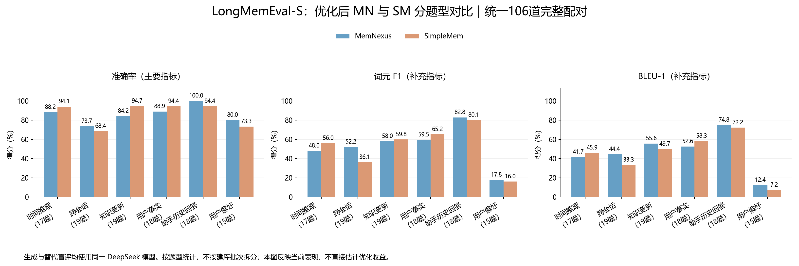

# 近期实验报告

这里保留近期可阅读的报告、汇总和可视化。HTML请下载后用浏览器打开；PNG可直接在GitHub查看。原始逐题输出、wire、费用账本和记忆库在本机 `result/` 保留。

| 内容 | 报告 | 数据 |
| --- | --- | --- |
| LME-S 106题MN/SM配对比较，统一合并统计 | [完整报告](lmes-106-20261124/report.html) · [中文分题型图](lmes-106-20261124/task_comparison_zh.png) · [优化变化图](lmes-106-20261124/optimization_change_zh.png) | [汇总](lmes-106-20261124/summary.json) · [历史协议摘要](lmes-106-20261124/protocol-summary.json) |
| 11月25日最终采用的查询传递、对话父上下文修复 | [验收报告](accepted-20261125/REPORT.html) | [15题汇总](accepted-20261125/summary.json) · [新规划5题](accepted-20261125/fresh-plan-summary.json) |
| 前一轮分块验收与采用/拒绝依据 | [分块报告](block-acceptance-20261125/REPORT.md) | [状态](block-acceptance-20261125/status.json) |

106题是历史代码的MN/SM对照；15题是后来MN内部的开发验证，两者不能合并成当前冻结版的新准确率。DeepSeek为替代评审，生成模型和评分口径见协议。固定代码供新实验使用不等于已证明大规模非劣或所有语义问题解决。

